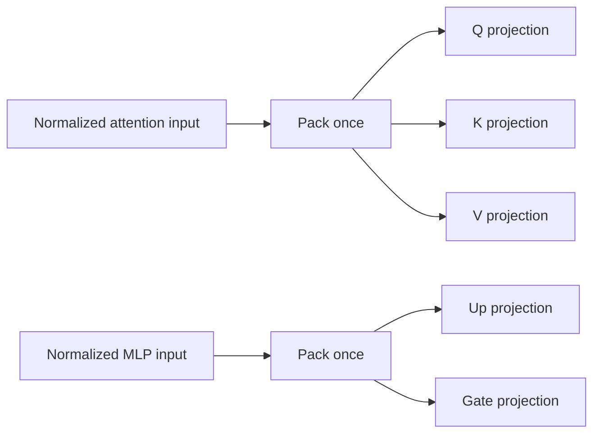

# Shared FP32 input packing

Leaf's decoder now uses the existing SIMD input packer and explicit projection
reuse in its ordinary optimized Windows FP32 path. Accurate FP32 already had
these paths. Matrix tiles, FMA/reduction order, weights and activation precision
are unchanged. This is an input-layout optimization, not weight packing,
quantization, a new matrix-multiplication algorithm, or a model-specific patch.

## Why packing exists

The decoder rearranges token rows into panels consumed by the existing 6x16
matrix tile. Q, K and V read the same normalized input; gated MLP up and gate
projections also share an input. Packing those values repeatedly is redundant.

The reuse promise is explicit: Q and up always refresh the panels. Only K/V and
gate can reuse them, and only with matching pointer, token count and width.
Pointer equality alone cannot prove unchanged values because normalized buffers
are overwritten repeatedly. Attention output, MLP down and vocabulary head
start their own input. An intervening nonpacked projection invalidates reuse.
Input scaling/calibration excludes reuse. Mixed quantized artifacts and scalar
or unsupported CPU paths retain their dispatch. No model-ID switch is involved.

SIMD packing is a transpose made of loads, shuffles and stores. It copies the
same FP32 bits; it does not round the inputs or change the arithmetic of GEMM.
The ordinary path uses it only when the optimized FP32 stack and AVX2/FMA are
active. Other platforms retain their existing qualification scope.

## Measurement method

The native profiler now reports nested `linear_details` separately from its
nonoverlapping phase totals: MLP/other projection time, their packing time, and
fresh-pack/reuse counts. Nested totals must not be added again to forward time.
The profiler includes first use and warmups. Profile means locate cost; they are
not release latency evidence. `tools/profile_decoder.py --fp32-math accurate`
can inspect the accurate policy explicitly.

On this host, the fresh baseline profiles put all linear work at 94-95% of
prefill, with MLP projections at 66-74%. Packing accounts for about 1-1.5%, so even
removing it entirely cannot solve the whole remaining latency gap.

Mean packing time and calls per 63-token prefill, averaged across the two
profile passes (three measured forwards plus one warmup each):

| Model | Packing before | Packing after | Fresh packs before -> after | Reuses after |
|---|---:|---:|---:|---:|
| SmolLM2-360M | 9.212 ms | 3.179 ms | 224 -> 128 | 96 |
| Qwen2.5-0.5B | 8.694 ms | 3.298 ms | 168 -> 96 | 72 |

These profile observations show about 65.5%/62.1% lower packing time and 42.9%
fewer fresh packs. They are not isolated kernel speed gates or whole-model
speedups. The accurate baseline already used 128/96 fresh packs respectively.

Separate unprofiled AB/BA screens use the same FP32 artifact, fast math policy,
last-token logits, one assigned CPU2 and Windows `better-battery` effective
mode. Each of two pairs contains seven measured samples plus three warmups.
No samples were filtered; counters/profiling were disabled. AC and effective
mode audits pass, as do every individual and pooled p90/p10 spread check.

| Model | Prefill before -> after | Pooled reduction | Median paired reduction |
|---|---:|---:|---:|
| SmolLM2-360M | 491.075 -> 481.898 ms | 1.87% | 1.72% |
| Qwen2.5-0.5B | 557.256 -> 553.898 ms | 0.60% | 0.92% |

Decode pooled medians are 80.00 -> 78.77 ms and 108.60 -> 108.84 ms respectively.
This change does not optimize the one-token decode path; no decode speedup is
claimed. The short screens do not meet the full six-pair/31-sample release
protocol and do not establish the required 2% prefill gain. `timing_qualified`
remains false. There is no new Ollama, llama.cpp or PyTorch comparison here.

## Correctness and packaging

- **1,372 unit tests passed**, with two optional skips; 33 focused cases passed.
- **1,462,208 packed values checked** against an independent source-bit oracle,
  including tails, strides, same-address updates, workspace growth/shrink,
  signed zeros, subnormals, infinities and NaN payloads.
- All **16 full 128-token trained blocks per policy** are bit-exact to their
  respective retained references: accurate math to the previously qualified
  accurate runtime, ordinary fast math to the prior Leaf runtime. The two policy
  checks cover 205,914,112 logit values each. This is not a new PyTorch oracle run.
- Twelve saved-reference accurate continuations, twelve old/new ordinary
  continuations, ten scalar/cache/thread/storage controls and eight ordinary
  regression controls pass, including GPT-2 and calibrated TinyLlama W8A8 cases.
- Tests exercise real reuse counts, changed inputs across requests/layers,
  scalar exclusions, source BF16 storage and mixed protected/calibrated tensors.
- The isolated installed wheel runs accurate FP32 + source BF16 head storage +
  explicit workers without compiler paths, overrides, Torch or Transformers.
  Installed executable code/constants match the trained-qualified binary.

The fast policy's older strict PyTorch tolerance misses remain unresolved;
bit-exact regression cannot turn those into passes. Default math selection and
BF16 storage scope are unchanged. Interior BF16 storage was not added.

[Evidence summary](../benchmark/validation/shared-input-packing/20261029/summary.json)
and [manifest](../benchmark/validation/shared-input-packing/20261029/manifest.json)
retain source/binary hashes, complete samples and test evidence. The next
optimization should target measured multiplication/MLP computation, with the
current power-mode limits and measured hardware headroom taken into account.
